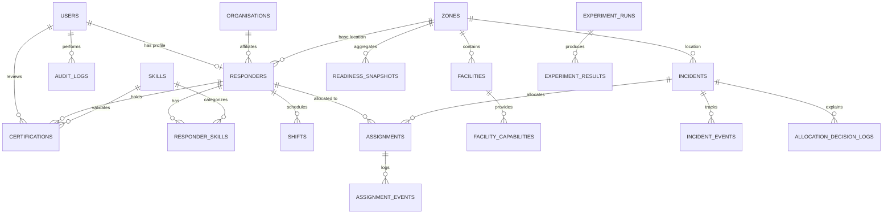

# CiviCare — Entity-Relationship Diagram (ERD) & Database Architecture

## 1. Relational Architecture Overview
CiviCare is engineered upon a **Third Normal Form (3NF)** relational database in **PostgreSQL**. It models real-world community first responder readiness, credential verification, geographic zone readiness, and atomic emergency allocations.

---

## 2. Relational Tables Summary (19 Tables)

| # | Entity Name | Primary Key | Key Foreign Keys | Purpose & Integrity Constraints |
|---|-------------|-------------|------------------|----------------------------------|
| 1 | `users` | `id` | None | System login identities (roles: `responder`, `admin`, `evaluator`). Passwords hashed via bcrypt. |
| 2 | `organisations` | `id` | None | Certified volunteer bodies (Red Cross, St John Ambulance). |
| 3 | `zones` | `id` | None | 15 Chennai zones with center coordinates, radius, population estimate. |
| 4 | `responders` | `id` | `user_id`, `organisation_id`, `base_zone_id` | Volunteer profiles with status (`active`, `suspended`) and live availability (`available`, `unavailable`, `on_break`). |
| 5 | `skills` | `id` | None | Standard emergency skills (CPR, bleeding control, choking relief, fracture stabilization). |
| 6 | `responder_skills` | `(responder_id, skill_id)` | `responder_id`, `skill_id` | M:N bridge table establishing clinical capabilities. |
| 7 | `certifications` | `id` | `responder_id`, `skill_id`, `reviewed_by` | Verified credentials. Hard constraint: `valid_from <= valid_until`. Only `verified_status = 'verified'` eligible. |
| 8 | `shifts` | `id` | `responder_id` | Time-bounded availability windows. CHECK constraint: `start_at < end_at`. |
| 9 | `facilities` | `id` | `zone_id` | Real sourced Chennai emergency hospitals with verified emergency contacts and coordinates. |
| 10 | `facility_capabilities` | `id` | `facility_id` | Documented capability codes (Trauma Lvl 1, Burns ICU, Stroke Unit, Cath Lab 24x7). |
| 11 | `incidents` | `id` | `zone_id` | Emergency requests reported by guest or bystander with location and priority. |
| 12 | `assignments` | `id` | `incident_id`, `responder_id` | Allocation records created transactionally to prevent duplicate simultaneous dispatch. |
| 13 | `incident_events` | `id` | `incident_id`, `actor_id` | Append-only incident status history (`REPORTED`, `ASSIGNED`, `COMPLETED`). |
| 14 | `assignment_events` | `id` | `assignment_id`, `actor_id` | Append-only responder status lifecycle (`OFFERED`, `ACCEPTED`, `EN_ROUTE`, `ARRIVED`, `COMPLETED`). |
| 15 | `readiness_snapshots` | `id` | `zone_id` | Zone coverage metrics and scores over time. |
| 16 | `allocation_decision_logs` | `id` | `incident_id`, `selected_responder_id` | Explainable decision log recording all candidates, exclusion reasons, and score breakdowns. |
| 17 | `experiment_runs` | `id` | None | Scenario benchmark metadata, parameters ($\alpha, \beta$), and outcome aggregates. |
| 18 | `experiment_results` | `id` | `run_id`, `zone_id` | Zone-level and metric-level outcomes for comparative evaluation. |
| 19 | `audit_logs` | `id` | `actor_id` | Immutable security log for administrative credential approvals and status changes. |

---

## 3. Database Views (Analytical SQL)

### View 1: `v_active_responder_readiness`
Real-time join of active responders, current duty shift, non-expired verified certifications, and active assignment lock checks.

### View 2: `v_zone_readiness_summary`
Aggregates free eligible responders by zone and computes readiness status:
- `ADEQUATE`: $> 3$ eligible responders
- `MODERATE`: $2 - 3$ eligible responders
- `UNDERSERVED_SINGLE`: Exactly $1$ eligible responder (fragile; candidate removal leaves zone empty)
- `CRITICAL_ZERO`: $0$ eligible responders (emergency desert)

### View 3: `v_incident_assignment_overview`
Multi-table analytical join connecting incidents, assigned responders, base zones, estimated travel distance, and lifecycle progress.
